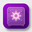

<div align="center">


# Prompt Vault

**A beautiful, fast vault for your AI prompts — organize, search, rate, and reuse your best prompts. Private by design: everything stays in your browser.**

`v2.1` · Next.js 16 · TypeScript · Tailwind CSS 4 · shadcn/ui

</div>

---

## ✨ Features

### Prompt management
- **Create, edit & delete prompts** with title, category, AI engine/model, prompt text, reference & result images, tags, star rating, and notes
- **Rich organization** — custom color-coded categories, favorites, tags, and full-text search (title, content, tags, engine)
- **6 sort modes** — newest, oldest, title A–Z, top rated, most used, and custom drag-order
- **3 view modes** — grid cards, image-first **cover cards** (great for visual prompts, with category-colored gradient fallback), and compact list
- **One-click copy** with usage tracking, plus share support on mobile
- **Undo / redo** for destructive actions

### Collections (Playbooks)
- Group related prompts into **ordered collections** (e.g. "Blog Workflow")
- **Drag & drop reordering** of steps
- **Copy all** — copies an entire playbook as one ordered block
- Add prompts to collections from the card menu, the details dialog, or the collection picker

### Templates & Analytics
- Built-in **template gallery** to kickstart your vault
- **Stats dashboard** — totals, category breakdown, top-rated and most-used prompts

### Privacy lock (PIN)
- Optional **PIN lock** with hint — full-screen keypad gate
- **Auto-locks** when the tab is hidden; unlock by keypad or keyboard
- Set / change / remove the PIN anytime

### PWA — installable with its own icon & badge
- **Install to home screen** on mobile and desktop (custom purple-vault icon set: 32 / 192 / 512 / maskable / apple-touch)
- **Works offline** — service worker caches the app shell
- App **shortcuts**: long-press the icon → *New prompt* (`/?action=new`) or *Collections* (`/?action=collections`)
- The app's own icon and **v2.1 badge** are shown in the footer

### Import / Export
- **Export** the whole vault as a dated JSON backup
- **Import** restores from a backup (with a confirm step before replacing an existing vault)
- Desktop: sidebar buttons · Mobile: **⋮ More options** menu in the header

### UX details
- Fully **responsive** — desktop sidebar + topbar, mobile 6-item bottom nav (Prompts · Favorites · New · Sets · Templates · Stats)
- **Light / dark theme**, glassmorphism header/nav, smooth Framer Motion touches
- **Keyboard shortcuts** (see below), toasts, skeleton loading, accessible labels throughout

## ⌨️ Keyboard shortcuts

| Shortcut | Action |
| --- | --- |
| `Ctrl/⌘ + N` | New prompt |
| `Ctrl/⌘ + K` or `/` | Focus search |
| `Ctrl/⌘ + Z` | Undo |
| `Ctrl/⌘ + Y` or `Ctrl/⌘ + Shift + Z` | Redo |
| `Esc` | Close dialogs |

## 🚀 Getting started

```bash
# install dependencies
bun install        # or npm install / pnpm install

# start the dev server (http://localhost:3000)
bun run dev

# lint
bun run lint
```

Other scripts: `build`, `start`, `db:push`, `db:generate`, `db:migrate`, `db:reset` (Prisma is preconfigured, though the vault itself stores data client-side).

## 🔒 Data & privacy

- All vault data (prompts, categories, collections, settings) is persisted in **your browser's localStorage** — nothing leaves your device
- Reference/result images are stored as compressed data URLs (max 1280px, JPEG) to keep the vault small
- Clearing browser data removes the vault — **export a JSON backup regularly**

## 🗂 Project structure

```
src/
├── app/                    # Next.js App Router (layout, page, globals.css, PWA metas)
├── components/
│   ├── prompt-vault/       # Feature components (topbar, sidebar, mobile-nav, cards,
│   │                       #   editor, collections, lock-screen, dialogs, pwa, …)
│   └── ui/                 # shadcn/ui primitives
└── lib/
    ├── prompt-vault/       # Zustand store (persisted), types, utils, sample data
    └── db.ts               # Prisma client (available for server-side features)
public/                     # PWA icons, manifest.webmanifest, service worker (sw.js)
prisma/                     # Prisma schema
```

## 🛠 Tech stack

| Layer | Choice |
| --- | --- |
| Framework | [Next.js 16](https://nextjs.org) (App Router) + React 19 |
| Language | TypeScript 5 (strict) |
| Styling | Tailwind CSS 4 + shadcn/ui (New York) + Radix primitives |
| State | Zustand with `persist` (localStorage) + undo/redo history |
| Drag & drop | dnd-kit |
| Icons | Lucide |
| Theming | next-themes (system / light / dark) |
| PWA | Custom manifest + service worker + maskable icons |
| Toasts | Sonner |
| DB (optional) | Prisma + SQLite |

---

<div align="center">

 **Prompt Vault v2.1** — your prompts, your device, your vault.

</div>
